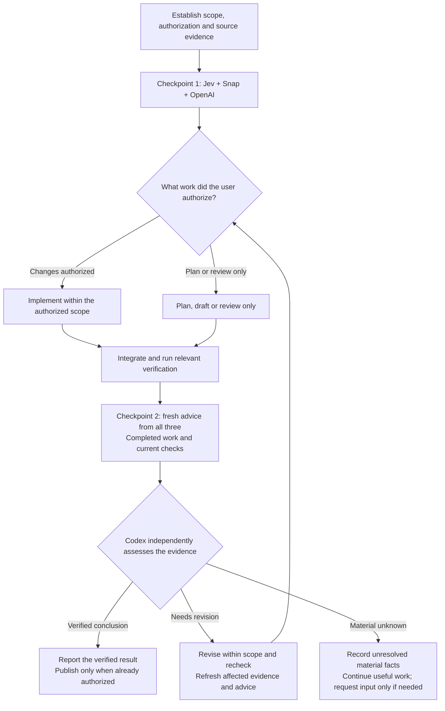
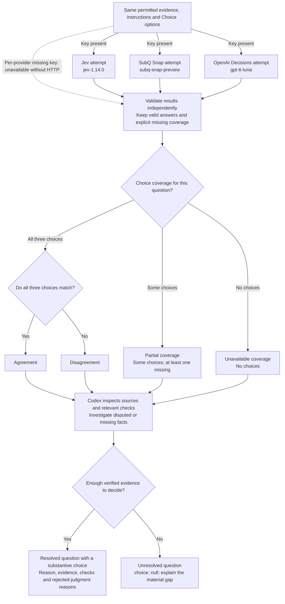

# How workflow decisions fork

Jev `jev-1.14.0`, SubQ `subq-snap-preview` and OpenAI Decisions `gpt-6-luna`
are required advisers at equal standing. They receive the same permitted evidence
and questions. Codex checks their judgments against sources and verification and
makes the final decision; agreement, confidence and voting do not establish truth.

## Task checkpoints and rework

This diagram covers substantial tasks. Small edits and direct factual answers
retain the lightweight path, including relevant verification and user authorization.
The coordinator owns checkpoint timing; the helper does not schedule these phases.

The first checkpoint precedes implementation, or substantive drafting/review for a
task without implementation. It cannot substitute for the final checkpoint.
Rework refreshes affected checks and consultations when the evidence, revision or
question meaning changes. Reuse remains within the same applicable checkpoint.
Adviser judgments grant no implementation or publication permission.

## Decision forks inside each checkpoint

The branches below describe each question. Provider status, overall consultation
availability and Codex's final decision are recorded separately.

| Observed choices for one question | Comparison status | Next step |
| --- | --- | --- |
| All three choices match | `agreement` | Codex verifies the claim against evidence |
| All three answer; choices differ | `disagreement` | Codex investigates and explains each rejected judgment |
| Some choices, including two conflicting answers and one missing adviser | `partial` | Keep those choices and the missing-coverage map; Codex verifies independently |
| No choices | `unavailable` | Record the gap and continue source-based work where possible |

A refusal supplies no choice and does not contradict the claim. OpenAI can refuse
one question while returning valid choices for others. Missing credentials,
timeouts, malformed responses and service errors remain explicit coverage limits;
they do not automatically reject a claim or block all useful work.

Each batch runs concurrently with a shared 30-second budget, one attempt per
provider and no automatic retries or replacement model. Required advisers cannot
be silently disabled. A material evidence change calls for an affected consultation
to be refreshed, rather than repeatedly asking unchanged questions until models agree.

`resolved` means a question has an evidenced substantive choice, which may support
or contradict a claim. It does not mean approval. Codex records a reason for every
actual provider choice it rejects. Missing material facts remain unresolved even
if all three advisers agree; the final record resolves only when every question
resolves.

Source contracts: [task orchestration](../skills/task-orchestration/SKILL.md),
[model policy](../skills/task-orchestration/model-policy.yaml),
[collection and adjudication](../skills/task-orchestration/scripts/consult_decisions.py),
[OpenAI response handling](../skills/task-orchestration/scripts/consult_openai.py),
and [global working scope](../global/AGENTS.md).
